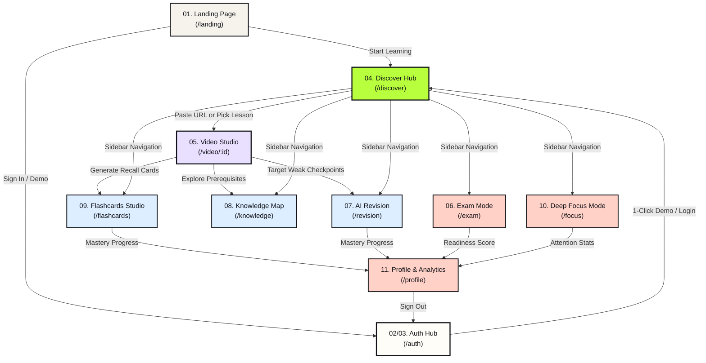

# Saras AI — Application Screens & Flow Documentation

This directory contains full-resolution captures of all primary screens in the Saras AI learning platform, along with architecture and screen flow blueprints.

---

## 📸 Screen Catalog

| File Name | Screen | Route | Description |
| :--- | :--- | :--- | :--- |
| **[`01_landing_page.png`](./01_landing_page.png)** | Landing Page | `/` or `/landing` | System architecture, multi-agent pipeline explanation, interactive features, and entry CTA |
| **[`02_auth_signin.png`](./02_auth_signin.png)** | Authentication (Sign In) | `/auth?mode=signin` | 1-Click Quick Demo logins (Kunal, Alex, Maya, Guest), credential login, local storage persistence |
| **[`03_auth_signup.png`](./03_auth_signup.png)** | Authentication (Sign Up) | `/auth?mode=signup` | Account creation, learning track chips (AI, Systems, CS, Exam), avatar color picker |
| **[`04_discover_dashboard.png`](./04_discover_dashboard.png)** | Discover Dashboard | `/discover` | Video URL ingestion bar, lesson library catalog, active study streak, quick-resume lessons |
| **[`05_video_learning_studio.png`](./05_video_learning_studio.png)** | Video Learning Studio | `/video/[id]` | Timestamped video player, chapter segmentation, AI smart notes, checkpoint quizzes, focus guardian |
| **[`06_exam_mode.png`](./06_exam_mode.png)** | Exam Simulation Mode | `/exam` | Holistic readiness score (0-100%), target exam countdown, practice milestones roadmap |
| **[`07_ai_revision.png`](./07_ai_revision.png)** | AI Revision Engine | `/revision` | Diagnostic drills targeting weak concepts where quiz accuracy was under 70% |
| **[`08_knowledge_map.png`](./08_knowledge_map.png)** | Knowledge Map | `/knowledge` | Interactive Directed Acyclic Graph (DAG) visualizing prerequisite and cross-topic links |
| **[`09_flashcards_studio.png`](./09_flashcards_studio.png)** | Flashcards Studio | `/flashcards` | SuperMemo-2 (SM-2) spaced repetition review with 3D card flips and confidence grading |
| **[`10_deep_focus_mode.png`](./10_deep_focus_mode.png)** | Deep Focus Mode | `/focus` | Fullscreen Pomodoro timer, webcam face attention tracker, distraction logging |
| **[`11_user_profile.png`](./11_user_profile.png)** | Student Profile & Analytics | `/profile` | Daily streak, mastered lessons count, 7-day activity timeline, study goals, sign-out |
| **[`12_screens_architecture_flow.png`](./12_screens_architecture_flow.png)** | Screen Flow Blueprint | `/flow-diagram` | High-resolution structured architecture diagram showing all screen transitions |
| **[`13_screens_flow_infographic.jpg`](./13_screens_flow_infographic.jpg)** | Visual Screen Flow Infographic | — | Neo-brutalist infographic illustration of the Saras AI user learning loop |

---

## 🗺️ Screen Navigation Flow Map

---

## 🔄 Core Screen Interactions

1. **Entry**: Users start on the **Landing Page** or **Auth Hub** where they can 1-click log in as demo profiles (*Kunal*, *Alex*, *Maya*, *Guest*) or register with local browser storage.
2. **Discovery**: From the **Discover Dashboard**, users enter any YouTube video URL or select from pre-ingested computer science & AI courses.
3. **Active Study**: The **Video Learning Studio** segments video into topic checkpoints, gating completion behind AI-generated quizzes, definition notes, and webcam gaze tracking.
4. **Reinforcement**: Post-video learning branches into:
   - **Flashcards Studio**: Spaced repetition drills.
   - **AI Revision**: Focused drills targeting previous quiz mistakes.
   - **Knowledge Map**: Interactive dependency DAG showing conceptual connections.
5. **Mastery Tracking**: Progress feeds into **Exam Mode** (readiness score) and **Student Profile** (study streak, goal tracker, activity history).
